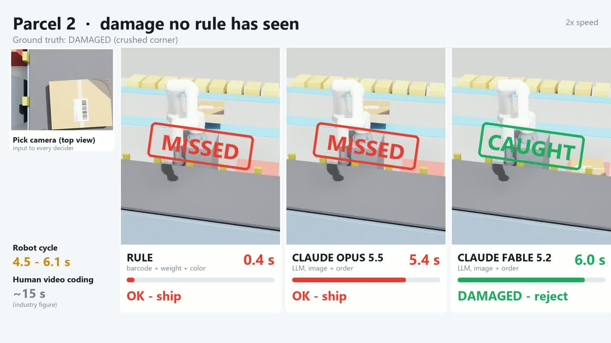

# Is an LLM too slow for a robot cell? — Rule + LLM + IK in an Isaac Sim outbound-check cell

**Question.** For physical AI in manufacturing *today*, a practical stack is **rules + an LLM for judgment + IK for motion**, instead of an end-to-end learned policy. A common pushback from logistics engineers is **speed**: an LLM call takes seconds, a sorting line does not wait.
This repo measures that trade-off in one simulated cell: same parcels, same camera, three deciders side by side.

Video (57 s): [`results/FC_outbound_check_linkedin_EN.mp4`](results/FC_outbound_check_linkedin_EN.mp4) · Korean long version (68 s): [`results/FC_outbound_check_linkedin.mp4`](results/FC_outbound_check_linkedin.mp4)

## Setup

| Item | What |
|---|---|
| Cell | Isaac Sim 6.0.1, infeed conveyor → overhead pick camera (3072×2304) → 6-axis cobot (RB16-900E model) with suction → sorter induct (OK) or reject tote (exception). Kinematic motion: Lula IK + trapezoid joint timing, no physics |
| Task | Fulfilment-centre outbound check, 6 outputs: OK · DAMAGED · RELABEL · SPEC_OUT (weight) · PACK_UNFIT · MANUAL (wrong-order label) |
| Data | 300 synthetic parcels (generic "FC SHIP LABEL", no real brand). `fc_stream` 200 (~5% faults) and `fc_hard` 100 (~86% faults incl. forms no rule was written for: crushed corner, oil stain, orange Korean fragile sticker, wrong-order label with smudged barcode) |
| Deciders | **Rule**: order-barcode match (zxing, rotation sweep) + weight ±5% + colour checks + red sticker template. **Claude Opus 5.5** and **Claude Fable 5.2** (low effort): parcel crop + label crop + order text. Gemini Flash also run (reported below, not in the video) |
| Gate | Rule first; only parcels the rule flags go to the LLM (rule-OK ships) |

## Results (measured unless marked)

**Accuracy** (`RESULTS_fc.md`)

| Decider | stream 200 correct | faults shipped as OK | OK parcels sent to a human | hard 100 correct | faults shipped as OK |
|---|---|---|---|---|---|
| Rule | 134 | 0 / 9 | 62 / 191 | 54 | 4 / 86 |
| Gemini Flash | 176 | 0 / 9 | 23 / 191 | 83 | 7 / 86 |
| Claude Opus 5.5 | 183 | 0 / 9 | 15 / 191 | 87 | 7 / 86 |
| Claude Fable 5.2 | 172 | 0 / 9 | 27 / 191 | **94** | **0 / 86** |

Opus and Flash missed mostly the crushed corners. LLM false alarms are mostly creased or glare labels sent to RELABEL. 42 of the rule's 62 false alarms are labels whose barcode the rule could not decode in the render (a limit of this rule, recorded as such).

**Speed** (median, end to end)

| | time |
|---|---|
| Rule | 0.5 s (stream) to 2.0 s (hard, rotation sweep) |
| Claude Opus 5.5 / Fable 5.2 | 4.7 s / 4.6 s via CLI (API part ~3.1 s) |
| Gemini Flash | 10.6 s via CLI |
| Robot pick-and-place cycle in this cell | 4.5 s (tote) to 6.1 s (induct) |
| Manual remote video coding (industry figure, BEUMER) | ~15 s |
| High-speed parcel induction robots (Kindred 1,600–2,000 PPH, Plus One 2,500+ PPH) | ~1.4–2.3 s per parcel |

**Cost per 10,000 parcels** (fault rate 0.3% assumed; missed fault $35 ≈ ₩49,000; needless human check ₩55 ≈ $0.04; USD at ₩1,400) — `img/cost10k.py` → `results/cost10k.json`

| Setup | errors + checks | LLM API | total |
|---|---|---|---|
| Rule only | $186 (₩26.1만) | – | **$186 (₩26.1만)** |
| Opus on every parcel (measured CLI price $0.062 ≈ ₩86 / call) | $120 (₩16.8만) | $617 (₩86.4만) | $737 (₩103만) |
| Fable on every parcel (measured CLI price $0.122 ≈ ₩171 / call) | $57 (₩8.0만) | $1,223 (₩171만) | $1,281 (₩179만) |
| Rule → flagged ~35% → Opus, direct API (**estimate**) | $135 (₩18.9만) | $57 (₩8.0만) | $192 (₩26.9만) |
| Rule → flagged ~35% → Fable, direct API (**estimate**) | $87 (₩12.2만) | $113 (₩15.8만) | $200 (₩28.0만) |

Break-even: about ₩20–40 (≈ $0.014–0.029) per LLM decision. CLI prices include the CLI's own system prompt, so they are an upper bound; the direct-API estimate counts only our prompt and two image crops (~2.9k input tokens, Opus $4/$20 per MTok, Fable scaled by the measured CLI price ratio). Flash price: not measured.

## What this does and does not show

1. **Speed is fine where the takt is seconds.** In a cobot cell (here 4.5–6.1 s per pick; aerospace drilling and assembly cells are slower still) an LLM decision of ~4–5 s is about one cycle, and ~3x faster than a human.
2. **The speed concern is valid for high-speed sortation.** At 1,600–2,500 PPH (1.4–2.3 s per parcel) a 3–5 s LLM call per parcel does not fit inline. There it belongs in the exception lane (the rule handles the bulk, the LLM replaces the 15 s human video-coding step), or it needs a small local model.
3. **LLMs win on faults no rule was written for** (hard set: rule 4 shipped faults, Fable 0).
4. **Cost, not speed, is the blocker today.** Calling a frontier model on every parcel costs more than it saves at a 0.3% fault rate. Routing only rule-flagged parcels brings it to about the rule's cost (estimate).
5. **Next:** a small model as first-pass filter (fine-tuned or distilled), frontier model only for low-confidence calls. A fine-tuned small model on the text version of this task reached 56/100 vs the rule's 84, so this needs the right data and the right role. Not yet run on images.

Limits: simulation and synthetic data, not field numbers; one robot model and one camera; latency measured through CLI tools on a shared GPU; local Qwen3-VL run is NOT_RUN for this set.

## Robot motion included (`img/_total_time.py`, `img/_total_time_v3.py`)

Time per box = decision + pick-and-place (6.144 s to the induct, 4.53 s to the tote, measured in the cell). Two layouts: the robot waits for the decision, or the next box is decided while the robot moves the current one.

| fc_stream 200 | robot waits | decided while moving |
|---|---|---|
| Rule | 553 boxes/h | 646 |
| Claude Opus 5.5 | 338 | 593 |
| Claude Fable 5.2 | 335 | 587 |

The rule's false alarms take the shorter tote path, which flatters its rate.

## Part 2: rebuilt pipeline (parcel-sort set, `results/RESULTS_v3.md`)

A second synthetic set (parcel sorting to chutes, `img/sets/stream.jsonl` 200 + `hard.jsonl` 100) with a rebuilt decider:

- In parallel: barcode + scale + a local damage check (CPU, ~0.4 s) and one **Gemini Decisions** call (`img/decide_decisions.py`, probabilities over chutes + 5 flags, p50 0.9 s; needs `GEMINI_API_KEY`).
- Damage sure → REJECT; overweight / red label / Decisions hazmat flag → MANUAL; barcode read and no flags → barcode chute; else the Decisions answer.
- Only doubtful boxes (damage suspect, confidence < 0.6, address-conflict flag) go to Claude Opus 5.5.
- v3 damage check (`img/damage_check_v3.py`): absolute stain colour and tear-interior colour. The v2 check measured darkness against the box's median brightness, so a wide wet stain hid itself.

Thresholds chosen on stream, applied unchanged to hard. Offline evaluation from stored predictions (`img/eval_v2.py`, `img/eval_v3.py`), no new API calls.

| hard 100 (54% exceptions, 21 damaged) | correct | damage caught | Opus share | mean decision | boxes/h, decided while moving | robot waits |
|---|---|---|---|---|---|---|
| Rule + vision (OCR) | 56 | 2/21 | 0 | 20.2 s | 167 | 141 |
| Gemini Decisions only | 71 | 0/21 | 0 | 0.8 s | 649 | 567 |
| Claude Opus 5.5 on every box | 94 | 17/21 | 100% | 3.9 s* | 672 | 393 |
| **Rebuilt (v3 F4)** | **99** | **21/21** | **18%** | **3.3 s** | **649** | **419** |

stream 200: rebuilt 199/200, Opus on 10% of boxes, mean 1.9 s, 594 boxes/h while moving.
Once the decision fits inside the move, the robot sets the rate; the gain is accuracy and cost.
\* Opus time here is server time (`api_ms`, close to a direct API call), shorter than the 4.6 s CLI round trip in part 1.

Limits: synthetic stains are flat ellipses, so colour separation is far cleaner than on real cartons. The v3 colour ranges were set after looking at missed images (hard included), so hard is not a strict holdout. Decisions not run on the fc set (NOT_RUN).

## Part 3: boxes land anywhere (`unstructured/`, `unstructured/RESULTS_unstructured.md`)

40 boxes with random size (20–50 cm), pose (±90°) and position, 26 damaged (torn or wet), 22 with a neighbouring box, 15 destinations. RB16 kinematics, Lula IK and point-sampled collision checks against belt, rails, neighbour box and drop funnels. Synthetic top-view images (PIL), no physics.

| Method | What it does | handled automatically /40 |
|---|---|---|
| Taught rule + vision | vision corrects box position and angle; centre suction; taught travel height (1.20 m); no collision check at run time | 12 (19 drops, 5 collisions, 4 IK failures) |
| Geometric rule | 54 candidates (9 suction points × 2 wrist flips × 3 travel heights) filtered by IK + collision + holding torque; fastest one; image not used | 19 |
| **Opus picks** | same valid candidates + the image, Opus (low) chooses one; called only when ≥ 2 suction points are valid (31 calls) | **23** |
| Ceiling | fastest valid candidate that does not drop the box | 23 |

When a safe candidate existed and a choice was needed (21 boxes): Opus 21/21, geometric rule 17/21.
Motion on the 12 boxes both handled: 7.64 s → 5.72 s (−25%), a gain that comes from the candidates, not the LLM. Opus adds ~4.5 s (server time) per box, which can run while the previous box moves. Candidate generation takes 55 s in this CPU Python prototype; a production planner is NOT_RUN. Opus cost $1.56 at CLI prices for 31 calls.
Limits: synthetic images make damage obvious; suction and collision margins are assumptions; the LLM had no MANUAL option, so its 12 failures are boxes with no safe point (rerun NOT_RUN). `plan.py` needs the `cellkit` helper (set `CELLKIT_DIR`), not included. `isaac/unstruct_video.py u_006` renders the same box three ways in the same RB16 Isaac cell (taught rule hits the belt rail, fastest valid grasp lands on the wet patch and drops, Opus's choice is placed); the clip's timer counts planning + robot motion.

## Files

| Path | What |
|---|---|
| `img/eval_v2.py`, `img/eval_v3.py`, `img/damage_check*.py`, `img/decide_decisions.py` | Part 2 pipeline and offline evaluation |
| `isaac/sort_cell.py` | Isaac cell: `--capture` pick-camera images, `--cycle` robot cycle times, `--video id:dest` front-view frames. Needs a small kinematics helper (`cellkit`: RB16 FK/IK and move timing) from a separate project, set `CELLKIT_DIR` |
| `img/gen_fc_set.py`, `img/fc_common.py` | synthetic parcel set + label/top textures, policy text |
| `img/decide_rule_fc.py` | rule baseline |
| `img/decide_llm_image.py` | LLM decider (`claude:<model>`, `agy:<model>`, local OpenAI-compatible server) with ROI crops (`ROI=1`) |
| `img/analyze_fc.py`, `img/cost10k.py` | tables, per-10k cost |
| `img/sets/`, `img/pred_*` | parcel sets and every decision (id, prediction, gold, latency, tokens, CLI cost) |
| `make_video_en.py`, `make_video.py` | video compositing (PIL + ffmpeg) |

---

### 한국어 요약
현재 제조 현장의 피지컬 AI는 "룰 + LLM 판단 + IK"를 섞는 구성이 현실적이라는 의견과, LLM은 느려서 라인에 못 쓴다는 현업 의견을 Isaac 출고 검사 셀에서 비교했다. LLM 판단 약 4.6초는 이 코봇 셀 사이클(4.5~6.1초)과 같은 수준이고 사람 15초보다 빠르다. 다만 1,600~2,500 PPH 고속 인덕션(건당 1.4~2.3초)에는 인라인으로 들어가지 않으므로 예외 처리 층에 둬야 한다. 정확도는 처음 보는 파손에서 LLM이 앞섰고(어려운 100건 Fable 놓친 오류 0, 룰 4), 걸림돌은 속도가 아니라 건당 비용이다(손익분기 건당 약 20~40원). 시뮬레이션 · 합성 데이터 결과다.
